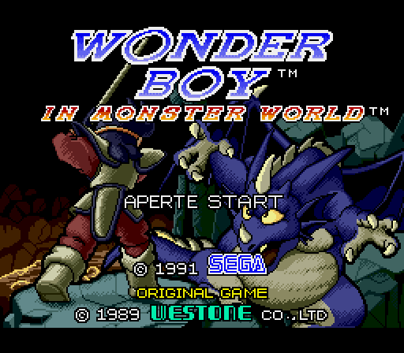
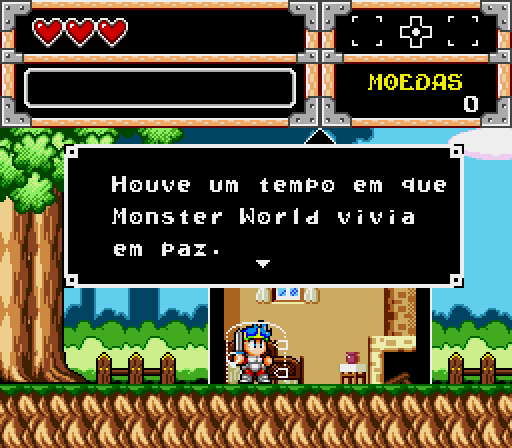
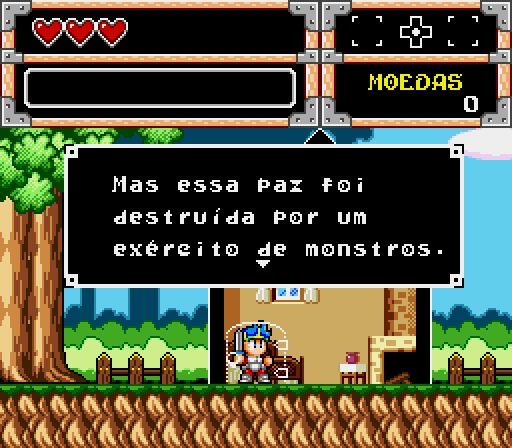
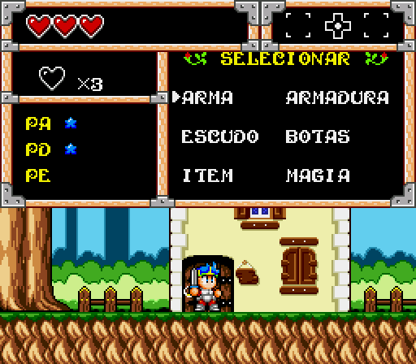
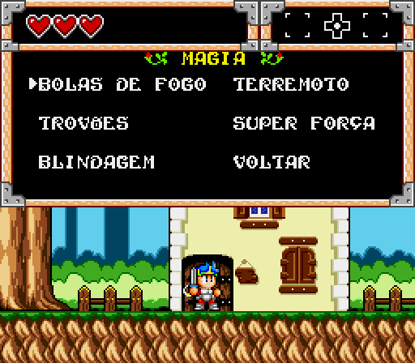
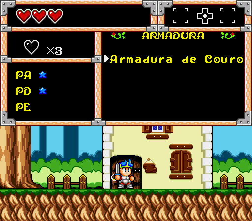
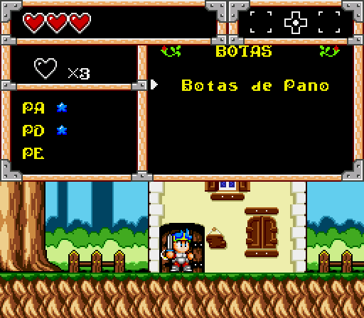

# Wonder Boy in Monster World — Tradução PT-BR

Tradução **completa** para português do Brasil de *Wonder Boy in Monster World*, o clássico de ação e aventura da Westone e da SEGA para Mega Drive (1991). Ajude Shion a salvar Monster World, agora com todos os diálogos, menus, itens e telas em português.

O projeto é distribuído **apenas como patch IPS**: você aplica o patch na sua própria cópia da ROM original. Nenhuma ROM faz parte deste repositório.

## Destaques

- **100% traduzido:** diálogos, lojas, estalagens, itens, equipamentos, magias, menus, mensagens do sistema, o quiz da Esfinge, nomes de lugares e os créditos.
- **Acentuação completa:** a fonte ganhou as letras do português (á, à, â, ã, é, ê, í, ó, ô, õ, ú, ç), desenhadas no estilo da original.
- **Gráficos traduzidos:** tela de título (APERTE START, NOVO JOGO, CONTINUAR), "MOEDAS" no HUD, placas de HOT e SAÍDA, FIM DE JOGO, FIM e CONTINUA... no final.
- **Texto natural:** português conversado, adaptado ao tom de cada cena, e não uma tradução ao pé da letra.
- **Revisada jogando**, do início ao fim, com cada tela conferida no jogo.
- **Save funcionando** nos emuladores com suporte à EEPROM do cartucho (veja "Como jogar").
- **Mesmo CRC32 da ROM original** (`1592F5B0`) e checksum do cabeçalho válido.

## Imagens

| | |
|:-:|:-:|
|  |  |
|  |  |
|  |  |
|  |  |

## Como jogar

1. Baixe o patch `wbmw-ptbr.ips` na página de [Releases](../../releases).
2. Tenha a ROM original, exatamente esta:

| Campo | Valor |
|---|---|
| Arquivo (GoodGen) | `Wonder Boy in Monster World (UE) [!].bin` |
| No-Intro | `Wonder Boy in Monster World (USA, Europe)` |
| Tamanho | 786.432 bytes (768 KB), sem cabeçalho SMD |
| CRC32 | `1592F5B0` |
| MD5 | `edba0bdb192d47712edbe0097f885f40` |
| SHA-1 | `87a968f773c7e807e647c0737132457b06b78276` |
| Checksum do cabeçalho (`0x18E`) | `9D79` |

3. Aplique o patch com um programa de IPS, como o [Floating IPS](https://www.smwcentral.net/?p=section&a=details&id=11474) ou o [Rom Patcher JS](https://www.marcrobledo.com/RomPatcher.js/) (no navegador). Em outra ROM (outra versão, com cabeçalho ou já modificada), o resultado não funciona.
4. Emuladores recomendados: **Genesis Plus GX** (RetroArch) ou **BlastEm**.

A ROM traduzida tem o mesmo CRC32 da original, então gerenciadores de coleção que identificam pelo CRC32 vão mostrá-la como a original. Para diferenciar, use o nome do arquivo ou o SHA-1.

## Para desenvolvedores

O restante deste README é sobre o ferramental que gera o patch a partir dos textos e gráficos do repositório.

### Requisitos

- Python 3.11+
- A ROM original descrita em "Como jogar", em `rom/`. `python -m ferramentas checar-rom` confere o hash.

### Publicar uma versão

O patch versionado fica em `patch/wbmw-ptbr.ips` e é regravado por todo `construir`; o teste `test_patch_versionado_atualizado` falha se ele estiver desatualizado. Para publicar:

1. `python -m ferramentas construir` e commit do `patch/wbmw-ptbr.ips` junto com a mudança.
2. Crie e envie a tag da versão: `git tag v1.0.0` e `git push origin v1.0.0`.
3. O workflow `.github/workflows/release.yml` cria a release da tag com o `wbmw-ptbr.ips` e um `.zip` com o patch e o `patch/LEIA-ME.txt`. O GitHub não tem a ROM, então ele não gera o patch: publica o que está versionado.

### Instalação

```bash
pip install -r requirements.txt
```

Coloque a ROM original em `rom/` (pasta ignorada pelo git).

### Estrutura

- `ferramentas/` — ferramental Python (CLI)
- `traducao/` — tabela de caracteres, glossário e textos (YAML)
- `graficos/` — fonte e telas (PNG indexado)
- `config/` — hashes esperados da ROM e configuração
- `docs/` — design, planos e documentação técnica

### Uso

Todos os comandos rodam a partir da raiz do projeto:

```bash
python -m ferramentas checar-rom   # confere o hash da ROM base em rom/
python -m ferramentas extrair      # extrai o texto da ROM para dados/scripts/ e traducao/textos/
python -m ferramentas verificar    # roda as checagens da tradução, sem gerar ROM
python -m ferramentas construir    # verifica e gera build/wbmw-ptbr.bin, .ips e relatorio.txt (e patch/wbmw-ptbr.ips)
python -m ferramentas importar-tiles --origem rom/<ROM>.bin --item final    # PNG de um item gráfico
```

- `extrair` lê a ROM base e grava `dados/scripts/esqueleto.json` (estrutura dos scripts, não editar) e os YAML em `traducao/textos/`. Pode ser rodado de novo: preserva o `pt`/`status` já escritos.
- `checar-rom` mostra SHA-1, CRC32 e tamanho e falha se a ROM não for a esperada (`config/rom.yaml`).
- `verificar` checa os caracteres contra a tabela, os códigos de controle, o glossário, o espaço do texto, as strings de tamanho fixo e a **largura de linha** e as **linhas por página** (pela janela de cada diálogo, `janelas` em `config/texto.yaml`: 23 colunas × 3 linhas na maioria; nos diálogos e nas lojas). Sai com código 1 se houver erro.
- `construir` não grava nada em `build/` se a verificação ou a validação da ROM falhar. O build é determinístico. O `relatorio.txt` traz o progresso e a linha `Espaço: N bytes usados de M em 0xA4C80–0xBFFF8`, seguida do que ocupa a região (o texto e, se houver, blocos da fonte realocados).

#### Fonte (letras acentuadas)

A fonte do jogo fica em `graficos/fonte/fonte.png`: PNG indexado de 16 × 16 tiles (128 × 128 pixels), em que o tile `n` é o caractere de código `n` (`A` = `0x41`, `á` = `0xB4`...). Cada 2 linhas de tiles são um bloco comprimido da ROM (blocos 0–7 da tabela `0x41000`). Para editar:

- use um editor que preserve a paleta indexada (Aseprite, GIMP em modo Indexado, Pro Motion) e só os índices 0–15: **1 = fundo, 15 = traço** (as cores do PNG são só para exibição; no jogo o fundo é preto e o traço, branco);
- os tiles `0x80–0x9F` (9.ª e 10.ª linhas de tiles do PNG, y = 64–79) **não aparecem no jogo**: nas cenas com texto essa área recebe gráficos do HUD. Os tiles `0x5C`, `0x5D` e `0x5F` são apagados pelo jogo. Não desenhe caracteres ali;
- para um caractere novo, desenhe o tile num código livre (`0xA0`, `0xAD–0xB0`, `0xBD`, `0xCC–0xCE`, `0xD9–0xDC`, `0xDE–0xFD`; `0xCF`, `0xD1`, `0xD2` e `0xDD` são usados pelas strings japonesas que sobraram (vram.md §3.2); `0xC6–0xCB` e `0xD3–0xD8` são o rótulo do HUD, e `0xC0–0xC5`, `0xD0`, `0xFE` e `0xFF` são gráficos das bolhas e de outros sprites, que não podem mudar) e acrescente `XX=caractere` em `traducao/tabela.tbl`. `verificar` acusa caractere da tabela com tile vazio ou invisível e caractere ou acento nos códigos do HUD.

`construir` só recomprime os blocos que mudaram (com o PNG intacto, a fonte da ROM fica byte a byte igual). Bloco que cabe no lugar original é gravado lá; senão vai para a região livre depois do texto. `extrair` gera o PNG e `graficos/fonte/fonte.yaml` (metadados e origem de cada glifo novo) só se o PNG ainda não existir: a fonte da ROM base com os glifos das letras acentuadas (`GLIFOS_ACENTOS` em `ferramentas/fonte.py`, desenhados pelo projeto no estilo da fonte original) e o rótulo do HUD.

#### Tela de título

Os textos da tela de título ("APERTE START", "NOVO JOGO", "CONTINUAR" e a seta do menu) são sprites desenhados com os tiles dos blocos `0x166–0x168` da tabela de gráficos. Ficam em `graficos/telas/titulo.png`: PNG indexado de 48 × 2 tiles (384 × 16 pixels), em que cada coluna de tiles é uma coluna de sprite, então o texto aparece como na tela. Índices: 0 = transparente, 1 = contorno, 15 = traço. O item está descrito em `config/graficos.yaml` (sem `origem`: o PNG é arte do projeto, editada à mão), e `graficos/telas/titulo.yaml` traz os metadados e as colunas de cada texto.

- Colunas do PNG usadas por cada texto (lidas nos sprites do jogo; `SPRITES_TITULO` em `ferramentas/graficos.py`):
  - "NOVO JOGO": colunas 0–9 (80 pixels, o espaço dos sprites do "NEW GAME");
  - "CONTINUAR": colunas 10–19 (80 pixels);
  - "APERTE START": colunas 20–31, colunas 34–41 e coluna 43 (a coluna 42 não aparece na tela);
  - seta do menu: colunas 32–33, no meio do "APERTE START";
  - colunas 44–47: sem uso.

  As posições dos sprites são as do jogo original: o texto não pode passar dessas colunas, e o que for desenhado nas colunas de um texto aparece nele (ex.: as colunas 20–21 são do "APERTE START", não do "CONTINUAR").
- O "CONTINUAR" cabe inteiro nas colunas 10–19: um contorno do R na coluna 20 apareceria como um traço à esquerda do A de "APERTE START" (`test_png_continuar_fica_nas_proprias_colunas`).
- "CONTINUAR" só aparece com jogo salvo. O roteiro `roteiros/titulo.yaml` (e `test_titulo_no_jogo`) não tem save e confere o "CONTINUAR" **só no VRAM** (tiles = PNG). Quais tiles os sprites dele usam vem de `testes/test_graficos.py::test_tiles_de_cada_texto_do_titulo_no_jogo`, que grava o jogo na estalagem, reinicia o console e lê a tabela de sprites do menu (ROM base). Ver o "CONTINUAR" traduzido na tela exige o mesmo caminho (gravar e reiniciar); foi feito uma vez à mão, sem captura versionada.
- `construir` recomprime só os blocos que mudaram. Bloco que cabe no lugar original é gravado lá; senão vai para a região livre depois do texto e da fonte. O logo não é tocado.
- `importar-tiles` não se aplica ao título (item sem `origem`): edite o PNG.

#### HUD ("MOEDAS")

O rótulo do quadro do ouro no HUD ("GOLD" no original) é escrito pelo código com as letras da fonte. Na tradução ele vira "MOEDAS", 3 pixels mais alto que o original para não encostar no valor (até 999999), dividido entre duas linhas de tiles:

- os 12 tiles ficam na fonte, códigos `0xC6–0xCB` e `0xD3–0xD8` de `graficos/fonte/fonte.png` (não são caracteres: não use esses códigos na tabela). São gerados por `ferramentas/fonte.py` (`HUD_TEXTO`, `HUD_SUBIDA`) junto com os acentos quando `extrair` gera a fonte; um PNG sem eles faz `verificar`/`construir` darem erro (o HUD mostraria kana);
- o código que imprime o rótulo em duas linhas é o par de patches `hud.moedas_chamada` e `hud.moedas_rotina` em `config/patches.yaml`. Mudar os códigos dos tiles exige mudar a string no patch (`testes/test_hud.py` confere os dois);
- `testes/test_hud.py::test_hud_moedas_no_jogo` grava as capturas em `build/capturas/hud_base/` e `build/capturas/hud_ptbr/` (campo e ouro no máximo).

#### Texto desenhado no cenário e no final

O texto que não sai da fonte (letras desenhadas nos blocos de gráficos) também é traduzido: "FIM" e "CONTINUA..." no lugar de "THE END" e "TO BE CONTINUED", "HOT" na placa das estalagens ("INN"), "SAÍDA" na placa de saída ("EXIT") e "FIM DE JOGO" no lugar de "GAME OVER". São quatro itens de `config/graficos.yaml` com disposição `fundo`: o PNG mostra cada bloco como 2 linhas de 16 tiles, na ordem do bloco, com os blocos empilhados.

- `graficos/telas/placas_hot.png`: os cinco blocos de cenário com a placa (`0x37`, `0x88`, `0xD3`, `0x10B`, `0x11C`, um por faixa de 16 pixels); a placa ocupa os tiles 12–13 e 28–29 (colunas 12–13 das duas linhas).
- `graficos/telas/placa_saida.png`: o bloco `0xB8`; a placa ocupa os tiles 8–13 e 24–29, e o acento do Í fica nos tiles de cima.
- `graficos/telas/final.png`: o bloco `0x2EE`; as letras do final são os tiles 16–31 (2.ª linha), montadas em 16 × 16 pixels com espelhamento. A posição de cada letra na tela vem do tilemap do final, que muda pelos patches `final.fim` e `final.continua` de `config/patches.yaml`: desenhar uma letra nova exige mudar o patch também.
- `graficos/telas/game_over.png`: o bloco `0xFF`, que é o texto inteiro do game over (16 × 2 tiles, na mesma ordem da tela). O tilemap não muda.
- As letras novas são do projeto, no estilo das originais (mesma paleta, traço e sombra). Ficam em `RETOQUES` de `ferramentas/graficos.py`, e `importar-tiles --origem "rom/Wonder Boy In Monster World (UE) [!].bin" --item <nome>` regenera o PNG e os metadados a partir da ROM base.
- `testes/test_texto_tiles.py` confere o desenho, os patches e as telas no emulador. As capturas ficam em `build/capturas/final_base/` e `final_ptbr/` (`fim.png`, `continua.png`), em `build/capturas/placas_base/` e `placas_ptbr/` (`sala_57.png` e `sala_59.png` com o "HOT", `sala_0a.png` com o "SAÍDA") e em `build/capturas/game_over_base/` e `game_over_ptbr/` (`game_over.png` e `game_over_4x.png`, a faixa do texto ampliada). Para chegar ao final, o teste usa uma cópia temporária da ROM que pula direto para o desfecho; para as placas, cópias que começam o jogo na sala da placa; para o game over, uma cópia em que o laço do jogo sempre cai no game over (detalhes em `docs/tecnico/mapa-rom.md` §8).

#### Menus do START e magias

Os rótulos do menu (cabeçalhos, opções, lista de magias e o nome da magia no HUD) são texto da fonte desenhado pelo código, não gráficos. Ficam em `traducao/textos/inline.yaml` (`menu.*`, `magia.*`, `magia_hud.*`) e são blocos repontáveis (`inline_repontavel.blocos` em `config/texto.yaml`): com algum `pt`, a lista inteira vai para o espaço livre e o código passa a lê-la por trampolins; cada rótulo tem a largura do seu painel e o `verificar` acusa o que não couber (regras no `docs/projeto/guia-traducao.md`; detalhes técnicos em `docs/tecnico/mapa-rom.md` §6, "Menus e magias"). `testes/test_menus.py::test_menus_no_jogo` grava as capturas em `build/capturas/menus_base/`, `menus_ptbr/` e as comparações `build/capturas/menus_*_comparacao.png`.

#### Onde editar os textos

Cada arquivo de `traducao/textos/*.yaml` é uma lista de entradas `id`, `en` (original, não editar), `pt` (sua tradução), `status` (`pendente`, `traduzido` ou `revisado`) e `nota`. `pt` vazio mantém o texto original. Arquivos: `dialogos` (conversas), `banco0_sistema` (menus e quiz), `banco1_itens` (nome completo dos itens: diálogos, loja e baú), `banco1_menu` (nome curto nas listas do menu; vazio = o completo), `banco2_nomes`, `banco3_lojas` (lojas, estalagem, ocarina) e `inline` (strings no código: em geral de tamanho fixo, o `pt` não pode passar do original; as mensagens do baú, `bau.*`, e os menus, `menu.*`/`magia.*`/`magia_hud.*`, vão para espaço livre e só respeitam a largura da linha ou do painel).

Tags usadas no texto (preserve-as no `pt`, na mesma ordem relativa):

| Tag | Significado |
|---|---|
| `[linha]` | nova linha na coluna do recuo (2) |
| `[quebra2]` | nova linha na coluna 0 |
| `[espera]` | espera o botão (não limpa a janela nem quebra a linha) |
| `[cor]` ... `[/cor]` | destaque de cor |
| `[s0:XX]`, `[s3:XX]` | insere a string `XX` do banco 0 (sistema) ou 3 (lojas) |
| `[item:XX]`, `[nome:XX]` | insere o nome de item (banco 1) ou nome próprio (banco 2) |
| `[$XX]` | byte de controle sem tag, por exemplo `[$04][$03]` (avança 3 colunas), `[$03][$06]` (velocidade), `[$0A][$02]` (recuo) e `[$01][$XX]` (atributo). Depois de `[$01]`, `[$03]`, `[$04]` e `[$0A]` vem sempre o argumento, também como `[$XX]`: o par é um código só (`[$04][$02]` avança 2 colunas, não é quebra de linha) |

Os códigos `[s0:..]`, `[item:..]`, `[nome:..]`, `[s3:..]` e `[$XX]` (incluindo o argumento, como em `[$04][$02]`) precisam aparecer iguais ao original e na mesma ordem (`verificar` acusa a diferença); `[linha]`, `[quebra2]`, `[espera]`, `[cor]` e `[/cor]` podem ser movidos. Em `verificar`, é erro uma linha mais larga que a janela do diálogo (23 colunas na maioria; o jogo quebraria no meio da palavra) e uma página com mais linhas do que a janela mostra (entre duas `[espera]`; a janela rola e as primeiras somem antes da leitura). Variáveis contam pelo tamanho da string do banco (o nome do item, quando o script o define, ou o maior nome; números com 6 dígitos). Regras e capturas em `docs/tecnico/mapa-rom.md`, "Largura de linha".

Para rodar os testes: `python -m pytest`.

### Compatibilidade de emuladores (save em EEPROM)

O jogo grava o save numa EEPROM serial (I2C, 128 bytes), não numa SRAM comum. O
cabeçalho do cartucho não diz isso; cada emulador reconhece o jogo por conta própria:

- **Genesis Plus GX** (RetroArch) e **BlastEm** reconhecem pelo código do produto
  (`G-4060`): a ROM traduzida salva e carrega normalmente.
- **ares** só emula a EEPROM para a ROM original exata (identifica pelo SHA-256 do
  arquivo). Com qualquer ROM modificada ele cria uma SRAM de 1 byte no lugar.

O build aplica o patch `eeprom.nack_sem_trava` (`config/patches.yaml`): sem resposta da
EEPROM o jogo não trava mais no START. Com a EEPROM presente o save não muda. No ares a ROM traduzida
roda, mas o save não fica gravado.

#### CRC32 e checksum iguais aos da original

A última etapa do `construir` grava 8 bytes de compensação no fim da ROM (`0xBFFF8–0xBFFFF`,
`FF` na original e nunca lidos pelo jogo; `compensacao` em `config/rom.yaml`) para que a
ROM traduzida tenha o **mesmo CRC32** da original (`1592F5B0`) e o **mesmo checksum do
cabeçalho** (`9D79` em `0x18E`), que continua válido (a soma das words confere). Nenhuma
etapa pode gravar nessa área: `regiao_destino` termina em `0xBFFF8` e o build recusa patch
ou região que a cubra. Sem nenhuma mudança na ROM, nada é gravado e a área fica `FF`.

Limites:

- o **SHA-256** (e o SHA-1/MD5) não pode ser preservado: o ares continua sem gravar o
  save, e o patch `eeprom.nack_sem_trava` continua necessário;
- ferramentas de catálogo que identificam ROMs pelo CRC32 (No-Intro/DAT, front-ends,
  gerenciadores de coleção) vão listar o arquivo traduzido **como a ROM original**.
  Para distinguir, use o SHA-1 ou o nome do arquivo.

### Emulador para testes

As capturas de tela e os testes de emulação usam o core libretro **Genesis Plus GX** controlado por Python (sem janela). O core não faz parte do repositório:

1. Baixe `genesis_plus_gx_libretro.dll.zip` (Windows 64 bits) do buildbot oficial: <https://buildbot.libretro.com/nightly/windows/x86_64/latest/>. Em Linux/macOS use o `.so`/`.dylib` equivalente e passe `--core`.
2. Extraia em `emu/genesis_plus_gx_libretro.dll` (pasta ignorada pelo git). O core cria `emu/sistema/` para seus arquivos.

**Versão validada:** o nightly baixado em 2026-11-11, que se identifica como `Genesis Plus GX v1.7.4 b9c2316` (o save state se identifica como `GENPLUS-GX 1.7.6`), com SHA-256 `eb8cf338bb7b6468777edbaf2f44dd9920a506b64e52e642cb116610eeecd28f`. O "latest" do buildbot pode mudar. O emulador confere o SHA-256 ao carregar o core: se ele for outro, há um `RuntimeWarning` alto, as capturas e a RAM continuam funcionando e `vram()` fica desativada. A VRAM sai do save state, cujo layout só foi conferido nessa versão; a extração também recusa estado de outra versão, de outro tamanho, ou com a SAT fora do lugar. Por isso, nesse caso os testes de VRAM falham.

Sem o core, os testes de `testes/test_emulador.py` são pulados.

Roteiros de captura ficam em `roteiros/*.yaml` (passos `esperar`, `apertar` + `quadros`, `capturar`, `vram`, `estado_salvar`, `estado_carregar`, `checar_fonte`, `repetir`; ver `ferramentas/emulador/roteiro.py`):

```bash
python -m ferramentas.emulador roteiros/boot.yaml            # ROM base
python -m ferramentas.emulador roteiros/boot.yaml --rom build/wbmw-ptbr.bin
```

As saídas vão para `build/capturas/<roteiro>/`. Botões: `cima`, `baixo`, `esq`, `dir`, `a`, `b`, `c`, `start`. Só uma instância do emulador por processo.
